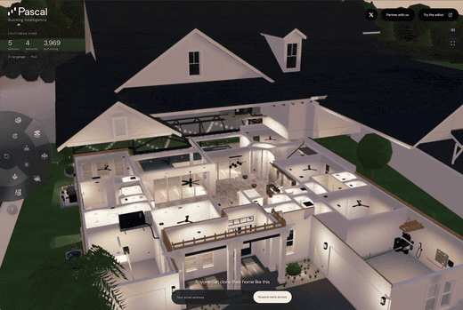
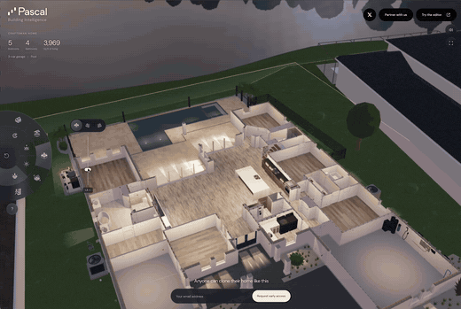
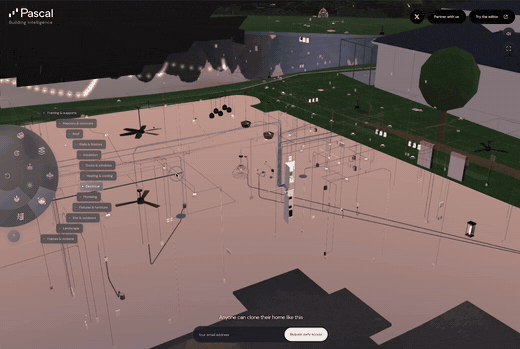
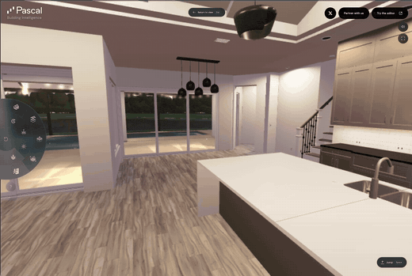
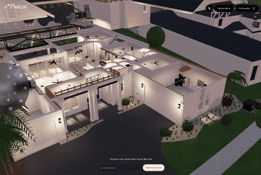
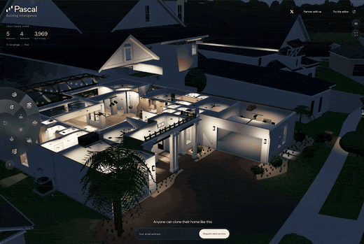

# Pascal Editor — open-source 3D architecture software for AECO

Create and edit 3D building models in your browser, run Pascal locally with its CLI, or connect
AI agents through the Model Context Protocol (MCP).

Pascal Editor is a local-first, MIT-licensed building editor for architecture, engineering,
construction, and operations (AECO) work. Model sites, buildings, levels, walls, slabs, roofs,
openings, rooms, and furniture; bring 3D scans in as reference layers for scan-to-BIM workflows
and model editable building elements over them; and let an agent read, edit, validate, and save
the same scenes. Built with React Three Fiber and WebGPU.

[](LICENSE)
[](https://www.npmjs.com/package/@pascal-app/core)
[](https://www.npmjs.com/package/@pascal-app/viewer)
[](https://www.npmjs.com/package/@pascal-app/cli)
[](https://discord.gg/XRKsDcpqgS)
[](https://x.com/pascal)

https://github.com/user-attachments/assets/063c0891-9ae5-4173-bd08-a101d9c3352b

## Start here

- **Run the editor locally** — `npx @pascal-app/cli editor`. See [Run the editor locally](#run-the-editor-locally).
- **Self-host it** — one container with SQLite storage. See [Self-host it](#self-host-it).
- **Embed the packages** — use the viewer or full editor in your React app. See [Use the published packages](#use-the-published-packages).
- **Connect an AI agent** — Claude Code, Cursor, Codex, or any MCP client. See [Connect an AI agent (MCP)](#connect-an-ai-agent-mcp).

## Connect an AI agent (MCP)

MCP is an open protocol that lets AI assistants call tools in other applications; Pascal's MCP
server gives an agent tools to inspect, edit, validate, and save building scenes.

Choose where the projects live:

- **Local (no account)** — the Pascal CLI runs an MCP service on your machine. Agents connect
  with `pascal mcp connect`, projects stay in `~/.pascal/data/pascal.db`, and nothing is uploaded.
  No Pascal account or API key is needed.
- **Hosted workspace** — `https://editor.pascal.app/api/mcp` works in your Pascal account or
  organization and needs that account's authorization. How a client authenticates depends on the
  client: the Cursor plugin uses browser sign-in, while Claude Code, Codex, and other clients send
  an API key created in [Pascal Settings](https://editor.pascal.app/settings). Some hosted
  operations, such as Architect runs, consume Pascal credits.

The local commands below need the `pascal` command on your `PATH` (Node.js 22.23.4+ on 22.x,
24.22.1+ on 24.x, or 26.12.1+):

```bash
npm install --global @pascal-app/cli
```

> [!IMPORTANT]
> Use one active agent client per local CLI service. The standalone local HTTP runtime shares
> active scene state between clients; use separate `PASCAL_HOME` directories and service
> processes when independent concurrent work is required. The hosted endpoint uses a separate
> session-isolated bridge.

### Claude Code

Register the local server (this runs `claude mcp add --scope user pascal -- pascal mcp connect`):

```bash
pascal mcp setup claude
```

Or install the plugin, which bundles the skills, the local `pascal` server, and a hosted
`pascal-hosted` server that prompts for an optional Pascal API key and stores it in the OS
keychain (leave it empty to stay local-only):

```text
/plugin marketplace add pascalorg/editor
/plugin install pascal-agent-skills@pascal
```

Use one or the other. Claude Code 2.1.258 loads both the user-scoped `pascal` server created by
`pascal mcp setup claude` and the plugin-provided server. Remove the manual entry
before reloading or restarting Claude Code so only the plugin owns the connection lifecycle:

```bash
claude mcp remove --scope user pascal
```

Use `/mcp` to remove or disable any project- or local-scoped Pascal connection too. Leaving both
connections active violates the one-active-agent-client-per-local-service requirement.

### Cursor

Install [Pascal from the Cursor marketplace](https://cursor.com/marketplace/pascal). It adds the
skills, a local `pascal` server launched through `npx` (no global install needed), and a hosted
`pascal-hosted` server. For hosted work, open **Customize → MCPs** and choose **Authenticate**
beside `pascal-hosted`; Pascal opens in your browser to sign in and choose a workspace. No API
key is needed. Leave `pascal-hosted` disconnected for local-only work.

Without the plugin, add the servers you want to `.cursor/mcp.json`:

```json
{
  "mcpServers": {
    "pascal": {
      "type": "stdio",
      "command": "npx",
      "args": ["--yes", "--package=@pascal-app/cli", "pascal", "mcp", "connect"]
    },
    "pascal-hosted": {
      "type": "http",
      "url": "https://editor.pascal.app/api/mcp",
      "auth": {
        "CLIENT_ID": "pascal-cursor",
        "scopes": ["openid", "profile", "offline_access", "scene:read", "scene:write"]
      }
    }
  }
}
```

The plugin's own configuration is [`.cursor-plugin/mcp.json`](.cursor-plugin/mcp.json).

### Codex

Register the local server (this runs `codex mcp add pascal -- pascal mcp connect`):

```bash
pascal mcp setup codex
```

Or install the plugin, which adds the skills and the same local server:

```bash
codex plugin marketplace add pascalorg/editor
codex plugin add pascal-agent-skills@pascal
```

For a hosted workspace, register the endpoint with an API key held in an environment variable
(Codex stores the variable name, not the key):

```bash
codex mcp add pascal-hosted \
  --url https://editor.pascal.app/api/mcp \
  --bearer-token-env-var PASCAL_API_KEY
```

### Other MCP clients

Print the generic configuration with `pascal mcp config`:

```json
{
  "mcpServers": {
    "pascal": {
      "command": "pascal",
      "args": ["mcp", "connect"]
    }
  }
}
```

The connector discovers the local service's port and private token itself. Check it with
`pascal mcp status` or `pascal doctor`. For hosted access, point a Streamable HTTP client at
`https://editor.pascal.app/api/mcp` with an `Authorization: Bearer <api key>` header.

### Agent skills

[](https://skills.sh/pascalorg/editor)

The plugins above include Pascal's public agent workflows. To install only the skills with
[skills.sh](https://skills.sh):

```bash
npx skills add pascalorg/editor \
  --skill pascal-3d \
  --skill furniture-fit
```

[`pascal-3d`](skills/pascal-3d/SKILL.md) covers safe local or hosted MCP setup and verified scene
work. [`furniture-fit`](skills/furniture-fit/SKILL.md) produces a bounded, evidence-based
footprint assessment. OpenClaw installation becomes available after the skills are published
under Pascal's ClawHub publisher.

### More on agents

- [MCP documentation](https://editor.pascal.app/docs/developers/mcp) and [local editor documentation](https://editor.pascal.app/docs/developers/local-editor)
- [llms.txt](https://editor.pascal.app/llms.txt) — documentation index for language models
- [skills/README.md](skills/README.md) — every plugin channel, per-host setup, and validation
- [`server.json`](server.json) — the `app.pascal/editor` manifest, published on the [official MCP Registry](https://registry.modelcontextprotocol.io/v0.1/servers/app.pascal%2Feditor/versions/latest)

## Run the editor locally

Create a persistent local Pascal installation without cloning this repository:

```bash
npx @pascal-app/cli editor
```

The CLI starts the editor and an authenticated MCP service in the background, selects
collision-free loopback ports, and keeps projects in `~/.pascal/data/pascal.db`. The web editor
runtime is downloaded once per version on the first command that starts the editor and verified
against a digest published inside the package; `pascal mcp connect` needs no download. See
[Run Pascal locally](https://editor.pascal.app/docs/developers/local-editor) for pnpm/Bun
commands, project management, updates, offline installs, storage paths, and troubleshooting.

## Self-host it

The editor ships as one container, `ghcr.io/pascalorg/pascal-editor`, tagged with the same
version as the npm packages (`latest` follows stable releases). Projects live in SQLite under
`/data`; one admin password protects the instance; `PASCAL_PUBLIC_URL` is read at runtime, so the
same image serves any domain.

```bash
docker run -d -p 3000:3000 -v pascal-data:/data \
  -e PASCAL_ADMIN_PASSWORD=change-me \
  -e PASCAL_PUBLIC_URL=https://pascal.example.com \
  ghcr.io/pascalorg/pascal-editor:latest
```

See [SETUP.md, "Self-hosting"](SETUP.md#self-hosting) for the compose file, the variables, agent
access and public embeds.

## Use the published packages

Install the full built-in viewer set, then load the built-in plugin once before mounting
`<Viewer>`:

```bash
npm install @pascal-app/core @pascal-app/viewer @pascal-app/editor @pascal-app/nodes
```

```typescript
import { loadPlugin } from '@pascal-app/core'
import { builtinPlugin } from '@pascal-app/nodes'

await loadPlugin(builtinPlugin)
```

See the [`@pascal-app/viewer` quick start](packages/viewer/README.md#usage) for a React example,
and [`@pascal-app/editor`](packages/editor/README.md) to embed the full editor. Capture sessions
ship as the optional `@pascal-app/core/capture` and `@pascal-app/viewer/capture` subpaths.
[`@pascal-app/ifc-converter`](packages/ifc-converter/README.md) converts IFC files into Pascal
scene graphs.

## Develop from source

Run from the repository root so the package watchers hot-reload changes in `packages/*`:

```bash
bun install
bun dev   # builds the packages, watches them, and serves the editor at http://localhost:3002
```

Build everything with `turbo build`, or one package with `turbo build --filter=@pascal-app/core`.
See [SETUP.md](SETUP.md) for prerequisites and environment variables,
[docs/architecture.md](docs/architecture.md) for how the packages fit together, and
[docs/releasing.md](docs/releasing.md) for npm, container, and MCP Registry publishing.

### Build a plugin

A plugin ships node kinds (schema, 3D/2D rendering, placement tools, inspector parametrics) and
left-rail panels through the same `Plugin` manifest the built-ins use. Start with the
[plugin guide](https://editor.pascal.app/docs/developers/plugins) and the worked example
[`pascalorg/plugin-trees`](https://github.com/pascalorg/plugin-trees).

## A first look at Pascal Next

[Explore the live demo](https://editor.pascal.app/next) — a real home reconstructed
in detail, from its rooms and finishes to the structure and systems behind the walls.
This hosted preview explores the direction of the next Pascal editor; the experience
shown here is not yet part of the open-source editor release.

| Exploded view — see how the home fits together | Cut view — slice through the building |
| --- | --- |
| [](https://editor.pascal.app/next) | [](https://editor.pascal.app/next) |
| **X-ray — reveal the modeled systems** | **Walkthrough — step inside at eye level** |
| [](https://editor.pascal.app/next) | [](https://editor.pascal.app/next) |
| **Interactions — open doors and explore** | **Environment — change the light and atmosphere** |
| [](https://editor.pascal.app/next) | [](https://editor.pascal.app/next) |

We are exploring what this could make possible for facility management, home services,
architecture, home building, and infrastructure.
[Join the discussion on X](https://x.com/pascal/status/2102097655031558496)
and tell us where you would use it.

Making a video, tutorial, article, or social post about Pascal? You are welcome to use and edit
this footage, including in monetized content, under [CC BY 4.0](docs/media/next-demo/LICENSE.md).
Credit Pascal, link the license, and note your edits; no separate permission is needed.
[Download the six original videos and see the creator guide](docs/media/next-demo/README.md).

## FAQ

**What is Pascal Editor?**
An open-source 3D building editor for architecture, engineering, construction, and operations. It
runs in the browser, locally through its CLI, or self-hosted, and exposes the same scenes to AI
agents over MCP.

**Is it free and open source?**
Yes. The editor, packages, CLI, and MCP server in this repository are MIT-licensed. Hosted
services at editor.pascal.app are separate from the open-source release and have their own
account terms.

**Does it work offline?**
The local CLI keeps projects on your machine, and its MCP service needs no network download.
Starting the editor downloads its web runtime once per version; for a host without network
access, pass `--runtime <directory-or-archive>`. See the
[local editor documentation](https://editor.pascal.app/docs/developers/local-editor).

**How do AI agents connect?**
Through MCP. Local agents run `pascal mcp connect` with no account; hosted workspaces use
`https://editor.pascal.app/api/mcp` with the client's sign-in or API key. See
[Connect an AI agent (MCP)](#connect-an-ai-agent-mcp).

**Does it support IFC?**
IFC import is provided by [`@pascal-app/ifc-converter`](packages/ifc-converter/README.md), which
converts IFC files into Pascal scene graphs. Sites, buildings, levels, walls, doors, windows,
slabs, columns, and spaces become native Pascal nodes when their parameters can be recovered;
other elements are kept as selectable imported meshes.

## Contributing

Bug fixes, features, docs and ideas are all welcome. Start with [CONTRIBUTING.md](CONTRIBUTING.md)
for setup, code style and the PR flow.

- New node kinds and sidebar panels ship as [plugins](https://editor.pascal.app/docs/developers/plugins) rather than edits to the built-ins
- Questions and ideas go to [Discussions](https://github.com/pascalorg/editor/discussions); reproducible bugs go to [Issues](https://github.com/pascalorg/editor/issues)
- Participation is covered by our [Code of Conduct](CODE_OF_CONDUCT.md)
- Security problems go to [SECURITY.md](SECURITY.md), not a public issue

## Contributors

<a href="https://github.com/Aymericr"></a>
<a href="https://github.com/wass08"></a>
<a href="https://github.com/sudhir9297"></a>

---

<a href="https://trendshift.io/repositories/23831" target="_blank"></a>
