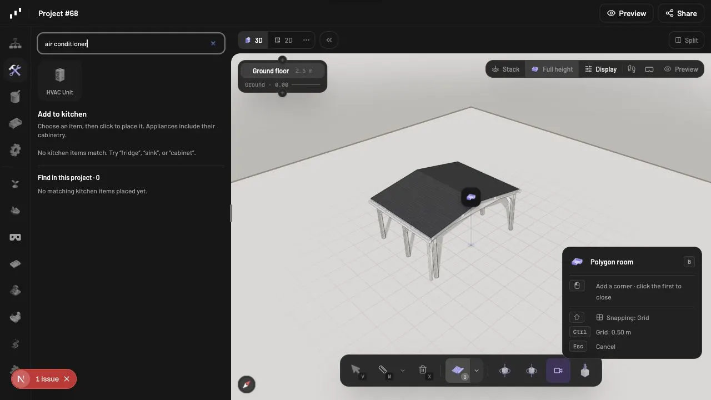
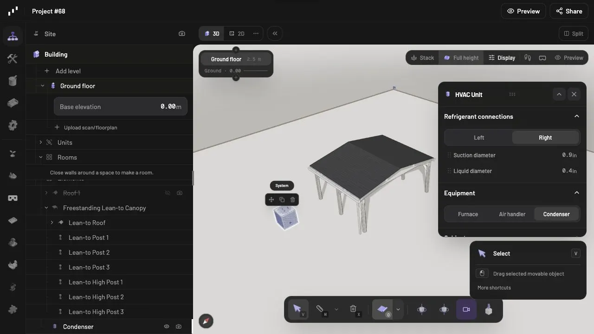
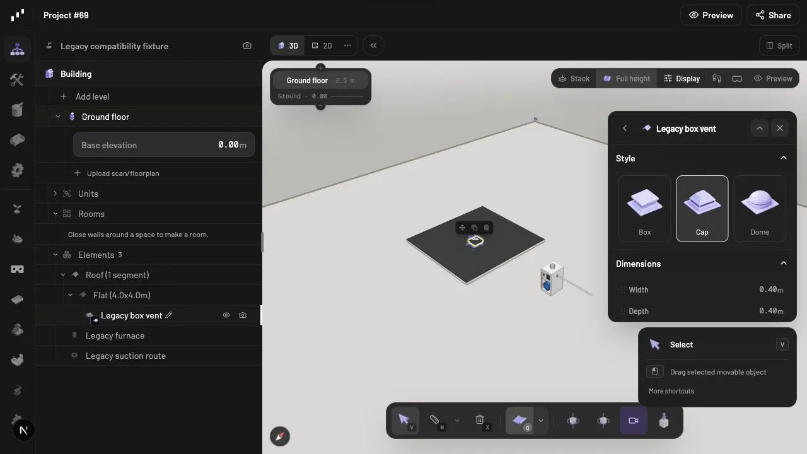
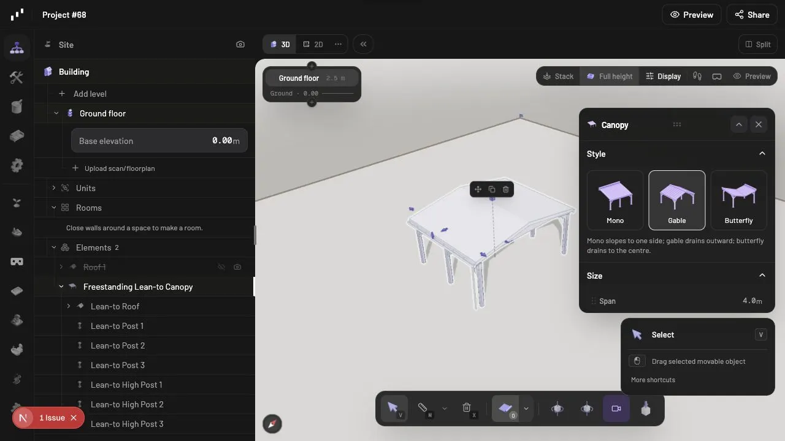
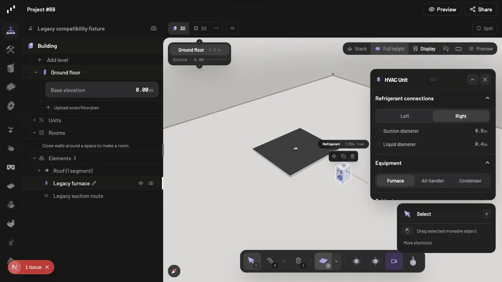

# PR 1125 local verification

Verified on 2026-10-22 with `bun dev --port 3017`, from `apps/editor` at commit `af201bd19`.

- Build search: entering “air conditioner” returns HVAC Unit.
- HVAC: placed a condenser and inspected its service face and separate suction/liquid diameter controls.
- Canopy: switched a freestanding canopy from Butterfly to Gable; checked the rendered roof and matching style cards.
- Legacy load: imported [legacy-scene.json](legacy-scene.json) through Settings → Load build into an empty project, then reloaded the browser. The furnace, refrigerant run, and roof-hosted box vent remained present. The furnace inspector recognized one connected refrigerant run and supplied default connection fields. The box vent retained Cap style and zero flashing extension, and could switch to Dome.

The legacy fixture is synthetic: it represents the pre-change schema by omitting the new HVAC face/diameter fields and box-vent flashing field, while retaining the existing lineset diameter data. It is not a historical customer scene. These manual checks complement the automated connection, placement, and preview-layer tests; they do not claim exhaustive manual coverage of every accessory or interaction.

## Build search

## HVAC placement and controls

## Roof accessory styles

## Legacy HVAC load

